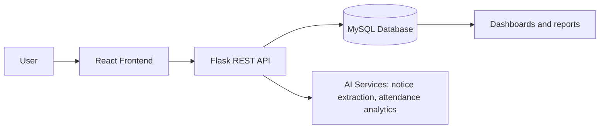

# AI-Powered College Management System

This project is a full-stack college management platform with separate student, teacher, and administrator dashboards built in React and Flask, backed by a MySQL-compatible schema.

## Architecture

The system follows a three-tier design:

- Frontend: React + Tailwind CSS for responsive dashboard UIs
- Backend: Flask REST APIs with role-based authorization and analytics services
- Database: MySQL schema with normalized tables and seeded fictional data



## Folder structure

```text
college-management-system/
├── backend/
│   ├── app/
│   │   ├── routes/
│   │   ├── services/
│   │   ├── __init__.py
│   │   ├── auth.py
│   │   ├── config.py
│   │   └── models.py
│   ├── .env.example
│   ├── requirements.txt
│   ├── run.py
│   └── wsgi.py
├── frontend/
│   ├── src/
│   ├── package.json
│   ├── vite.config.js
│   ├── postcss.config.js
│   ├── tailwind.config.js
│   └── index.html
├── database/
│   ├── schema.sql
│   └── sample_data.sql
├── docs/
│   ├── architecture.md
│   ├── implementation-plan.md
│   └── api-guide.md
├── .gitignore
├── .env.example
├── README.md
└── docker-compose.yml
```

## Phase plan

1. Phase 1: project structure, schema, and UI shell
2. Phase 2: authentication and role-based dashboards
3. Phase 3: student, teacher, and admin management flows
4. Phase 4: attendance, timetables, assessments, and assignments
5. Phase 5: notices, notifications, examinations, and seat allocation
6. Phase 6: AI notice processing and academic analytics
7. Phase 7: testing, deployment, and documentation

## Setup instructions

### Backend

```bash
cd backend
python -m venv .venv
source .venv/bin/activate
pip install -r requirements.txt
cp .env.example .env
python run.py
```

### Frontend

```bash
cd frontend
npm install
npm run dev
```

### MySQL

Import the schema and sample data:

```bash
mysql -u root -p < database/schema.sql
mysql -u root -p < database/sample_data.sql
```

## Demo login accounts

- Admin: admin@college.edu / admin123
- Teacher: teacher1@college.edu / teacher123
- Student: student1@college.edu / student123

## Major features

- Student attendance and timetable views
- Teacher subject and class management
- Administrator cohort management
- Role-based access controls and secure authentication
- Smart attendance analysis and notification generation
- Notice extraction and deadline review workflow
- Academic analytics and dashboard summaries

## Important note

This repository is intentionally designed as a practical, academic-project-ready foundation with a clean architecture and working data flow. Production deployment should use a valid MySQL instance and stronger secrets, CORS, and deployment hardening in a real environment.
